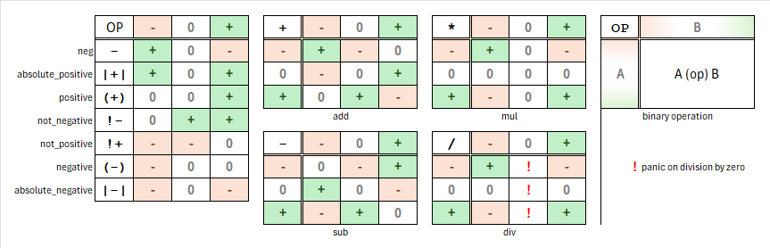
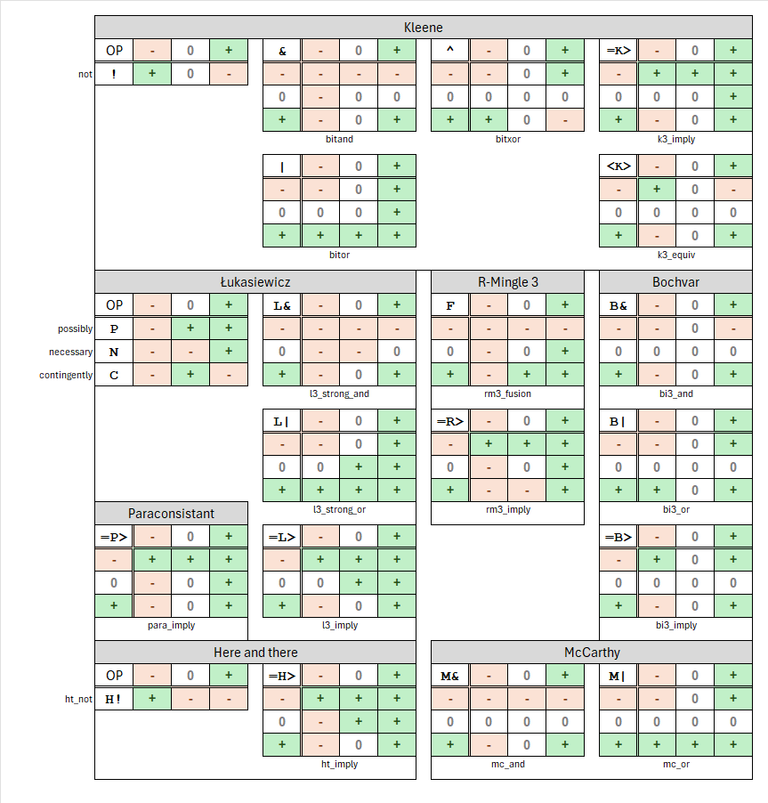
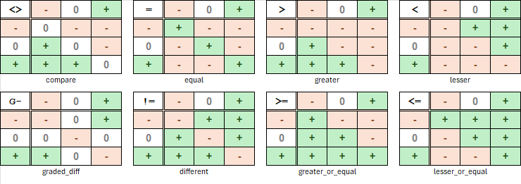
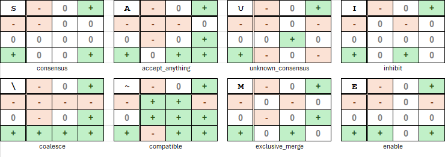
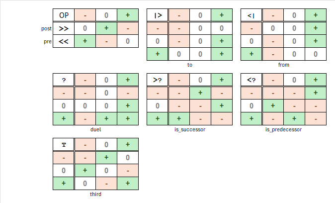

# Balanced Ternary

[](https://github.com/Trehinos/balanced-ternary/actions/workflows/rust.yml)

A Rust library for [balanced ternary](https://en.wikipedia.org/wiki/Balanced_ternary)
arithmetic and three-valued logic. In a balanced numeral, `+`, `0`, and `-`
are digits with values +1, 0, and −1. For example, `+--` means 9 − 3 − 1 = 5.

## Getting started

```toml
[dependencies]
balanced-ternary = "3"
```

The library supports `no_std` and uses `alloc` for growable collections.
Cargo enables `tryte` and `ternary-store` by default. Each enables
`ternary-string`. To select a subset, set `default-features = false` and
list the features you need.

| Type          | Cargo feature    | Use it for                                                                                                                                |
|---------------|------------------|-------------------------------------------------------------------------------------------------------------------------------------------|
| `Digit`       | Always available | Single-trit arithmetic and logic.                                                                                                         |
| `Ternary`     | `ternary-string` | Arbitrary-precision signed arithmetic. Equality, ordering, and hashing use the numeric value.                                             |
| `Tryte<N>`    | `tryte`          | An exact-width word. Addition, subtraction, and multiplication wrap modulo `3^N`.                                                         |
| `Ter40`       | `ternary-store`  | A bounded 40-trit integer in an `i64`. Operators panic on overflow. Use `checked_*` to handle failure.                                    |
| `TritsChunk`  | `ternary-store`  | Five trits in one byte.                                                                                                                   |
| `DataTernary` | `ternary-store`  | Variable-length chunk storage. Equality and hashing include leading zero chunks. Convert to `Ternary` for numeric ordering or arithmetic. |

## Parsing and formatting

Balanced parsing and display preserve the input digits. Ordinary base-3
conversion writes a normalized numeral using `0`, `1`, and `2`, with a
leading minus sign for negative values.

```rust
use balanced_ternary::Ternary;

let five = Ternary::try_parse("00+--").unwrap();
assert_eq!(five.to_string(), "00+--");
assert_eq!(five.to_unbalanced(), "12");
assert_eq!(five.checked_to_dec(), Some(5));
assert_eq!(Ternary::try_from_unbalanced("+0012").unwrap(), five);
```

## Fixed-width arithmetic

```rust
use balanced_ternary::Tryte;

type Word = Tryte<2>;
let one = Word::from_i64(1);
let two = Word::from_i64(2);

assert_eq!(Word::MAX + one, Word::MIN);
assert_eq!(Word::MAX.checked_add(one), None);
assert_eq!(one / two, Word::ZERO); // Integer quotient.
assert_eq!(one.checked_modular_div(two), Some(Word::from_i64(-4)));
```

## Compact storage

Encoding rounds the width up to a multiple of five. Choose the decoding
method according to the representation the caller needs.

```rust
use balanced_ternary::dter;

let stored = dter("00+");
assert_eq!(stored.to_fixed_ternary().to_string(), "0000+");
assert_eq!(stored.to_ternary().to_string(), "+");
assert_ne!(stored, dter("00000+")); // An additional stored chunk.
```

## Digit operations

`Digit` provides Kleene, Bochvar, Łukasiewicz, RM3, HT, paraconsistent, Post logic operations...
There are 13 unary and 43 binary operations.  
Apply a digit function to a whole word with the `DigitOperate` trait.

```rust
use balanced_ternary::concepts::DigitOperate;
use balanced_ternary::{Digit, Ternary};

let value = Ternary::parse("+0-");
assert_eq!(value.each(Digit::possibly).to_string(), "++-");
```

### Arithmetic operations 



### Logic operations



### Comparison operations



### State manipulation



### Cycles and transitions



## Documentation

Read the [API reference for the published crate](https://docs.rs/balanced-ternary).
For the current checkout, run `cargo doc --all-features --open`.

## License

Copyright (c) 2025-2026 [Sébastien GELDREICH](mailto:dev@trehinos.eu).  
Licensed under the [MIT License](LICENSE).
